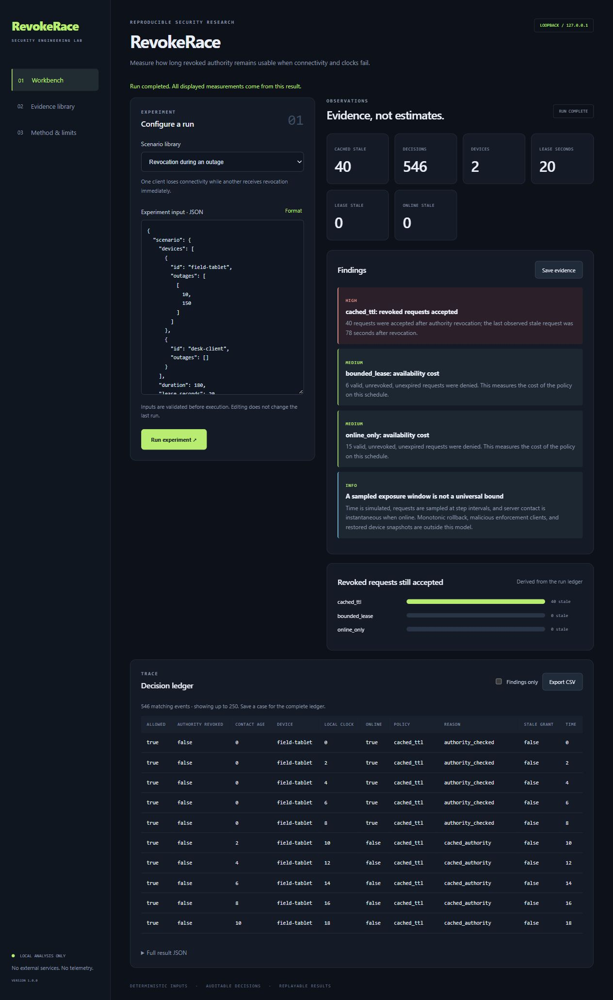

# RevokeRace

**Revocation exposure under outages and clock rollback.**

[](https://github.com/Ashin-06/RevokeRace/actions/workflows/checks.yml)


RevokeRace makes the security–availability tradeoff of offline authorization measurable. Give three enforcement policies the same connectivity schedule, clock faults, and revocation event; inspect every decision against the authority’s time oracle.

It includes wall-clock TTL caching, a monotonic expiry plus freshness lease, and online-only enforcement; configurable offset/drift/rollback; HMAC tampering fixtures; lease-budget sweeps; and deterministic evidence replay.

The default outage experiment produces **40 stale cached grants**, **0 stale bounded-lease grants**, and **0 stale online-only grants** across 546 decisions. The offline-gap experiment deliberately shows that a still-fresh lease can accept newly revoked authority. These are observations on supplied schedules, not universal security bounds.

## Run locally

Requires Python 3.10+ on Windows, macOS, or Linux. Use a virtual environment. From the repository root:

```sh
python -m venv .venv
```

Activate with `.venv\Scripts\Activate.ps1` in PowerShell, or `source .venv/bin/activate` on macOS/Linux, then:

```sh
python -m pip install -e .
python -m revokerace serve
```

Open **http://127.0.0.1:8761**. Select a scenario, edit JSON, run it, inspect findings and the decision ledger, export CSV, and save a replayable case. The Evidence library verifies saved cases and offers HTML reports and ZIP export. The UI is local, responsive, keyboard-accessible, and uses no external scripts or fonts.



## Reproduce from the CLI

```sh
python -m revokerace demo --output .lab/demo-case
python -m revokerace verify .lab/demo-case
python -m revokerace bundle .lab/demo-case .lab/demo-case.zip
python -m revokerace run examples/outage.json --output .lab/custom-case
python -m revokerace benchmark
```

Output destinations must be new; existing evidence is never overwritten. `presets` prints all runnable inputs. Run `python -m revokerace --help` for the command reference. Exit code 0 means the command completed, 1 means evidence verification failed, and 2 means invalid input or an operational error. A completed experiment may contain findings; inspect the JSON summary rather than interpreting exit 0 as a clean security verdict.

```sh
python -m revokerace sweep examples/outage.json --budgets 0,5,15,30,60
```


## Evidence and methodology

Every saved case includes canonical input/result JSON, a standalone escaped HTML report, and a SHA-256 manifest. Verification checks hashes **and replays the experiment**. Reports display up to 200 ledger rows; the dashboard displays up to 250; result JSON retains the complete bounded ledger. CSV export includes all events matching the current filter and neutralizes spreadsheet formula prefixes.

- [Method, input contract, and limits](docs/METHOD.md)
- [Threat model](THREAT_MODEL.md)
- [Recorded benchmark results](docs/benchmark-results.json) — regenerate with `benchmark`
- [API and architecture](docs/ARCHITECTURE.md)
- [Contributing and validation](CONTRIBUTING.md)

## Validation

```sh
python -m unittest discover -s tests -v
python -m pip install ruff
python -m ruff check --select F,E9 .
```

GitHub Actions runs tests, static checks, JavaScript syntax validation, and all fixture benchmarks on Python 3.10/3.12 for Windows and Ubuntu. Browser behavior is manually checked separately. These projects are research workbenches with explicit model limits; a passing fixture suite is not a production security assessment.

## License

[MIT](LICENSE). Maintained by [Ashin-06](https://github.com/Ashin-06).
